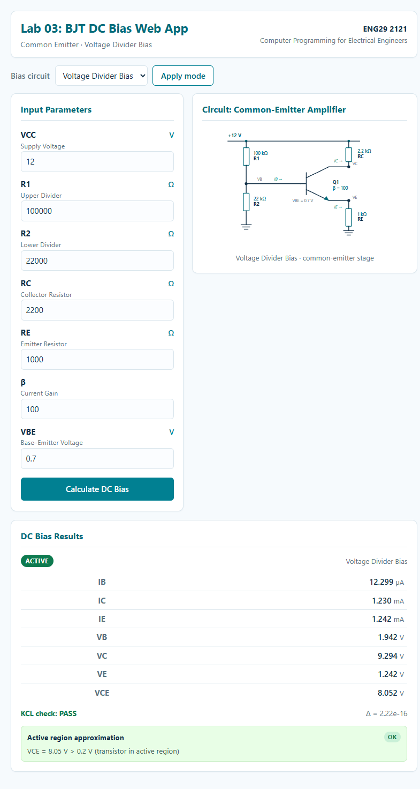

# Lab 3 — Validation Record (BJT DC Bias Web App)

วันที่ตรวจ: 2026-11-17
แอปที่ตรวจ: `http://127.0.0.1:5000/` (Flask dev server, Python 3.12)
Browser: Chromium ใน OpenCode Review pane (รัน A1–A5 จริงผ่านฟอร์ม)

## วิธีตรวจ

1. เปิดหน้าแรก → เลือกโหมดในช่อง **Bias circuit** แล้วกด **Apply mode**
   (ตรวจว่าฟอร์มเปลี่ยนช่องตามโหมด: Divider ใช้ `R1/R2`, Fixed ใช้ `RB`, Emitter ใช้ `RB/RE`)
2. กรอกค่าตามตาราง A1–A5 (หน่วย **Ω** ตามที่ฟอร์มต้องการ) แล้วกด **Calculate DC Bias**
3. อ่านค่าที่แสดงจริงจากตาราง `DC Bias Results` เทียบกับค่าอ้างอิงที่คำนวณอิสระ
4. เกณฑ์ผ่าน: `|ΔIC| ≤ 0.01 mA` และ `|ΔVCE| ≤ 0.02 V` (เทียบค่าที่แสดง 3 ตำแหน่งทศนิยม
   กับค่าอ้างอิงที่ยังไม่ปัดเศษ) + ต้องได้ `ACTIVE` และ `KCL check: PASS`

ใช้ร่วมกันทุกเคส: `VCC = 12 V`, `RC = 2200 Ω`, `β = 100`, `VBE = 0.70 V`

## ผล A1–A5 (จาก Browser จริง)

| เคส | โหมด / อินพุต | IC คาดหมาย | IC ที่แสดง | ΔIC | VCE คาดหมาย | VCE ที่แสดง | ΔVCE | Region | KCL | ผล |
| --- | --- | --- | --- | --- | --- | --- | --- | --- | --- | --- |
| A1 | Divider · R1=100000, R2=22000, RE=1000 | 1.229858 mA | **1.230 mA** | +0.000142 | 8.052155 V | **8.052 V** | −0.000155 | ACTIVE | PASS | ✅ |
| A2 | Fixed · RB=1000000 | 1.130000 mA | **1.130 mA** | 0.000000 | 9.514000 V | **9.514 V** | 0.000000 | ACTIVE | PASS | ✅ |
| A3 | Emitter · RB=1000000, RE=1000 | 1.026340 mA | **1.026 mA** | −0.000340 | 8.705450 V | **8.705 V** | −0.000450 | ACTIVE | PASS | ✅ |
| A4 | Emitter · RB=1000000, RE=2000 | 0.940100 mA | **0.940 mA** | −0.000100 | 8.032779 V | **8.033 V** | +0.000221 | ACTIVE | PASS | ✅ |
| A5 | Fixed · RB=0 | — | ไม่มีผลคำนวณ | — | — | ไม่มีผลคำนวณ | — | — | — | ✅ |

### รายละเอียดค่าที่แสดง (A1–A4)

| เคส | IB | IC | IE | VB | VC | VE | VCE | Δ (KCL) |
| --- | --- | --- | --- | --- | --- | --- | --- | --- |
| A1 | 12.299 µA | 1.230 mA | 1.242 mA | 1.942 V | 9.294 V | 1.242 V | 8.052 V | 2.22e−16 |
| A2 | 11.300 µA | 1.130 mA | 1.141 mA | 0.700 V | 9.514 V | 0.000 V | 9.514 V | 4.34e−19 |
| A3 | 10.263 µA | 1.026 mA | 1.037 mA | 1.737 V | 9.742 V | 1.037 V | 8.705 V | 4.34e−19 |
| A4 | 9.401 µA | 0.940 mA | 0.950 mA | 2.599 V | 9.932 V | 1.899 V | 8.033 V | 2.22e−16 |

## ข้อสังเกตจากผลจริง

- **A4 เทียบ A3**: เปลี่ยน `RE` จาก 1 kΩ → 2 kΩ ทำให้ `IC` ลดจาก 1.026 → 0.940 mA
  ตามตัวหาร `(β+1)RE` และ `VCE` ลดจาก 8.705 → 8.033 V (ลดลงแต่ยังอยู่ใน active region)
- **A2 (Fixed)**: `VE = 0.000 V` และ `VB = VBE = 0.700 V` ตามแบบจำลอง emitter ต่อกราวด์ตรง
- **A5 (RB = 0)**: แสดงข้อความ `Fixed Bias — RB must be greater than zero.`
  และ **ไม่มีตารางผลค้าง** (status ยังเป็น `No calculation yet / READY`)
- ทุกเคส A1–A4 แสดงกล่องสถานะ `Active region approximation · OK · VCE > 0.2 V`
- หน้าเว็บไม่มี console error ขณะรัน A1–A5

## หลักฐานภาพ

## การถดถอย (Lab 2)

ชุดทดสอบเดิมยังผ่าน **28/28** (`python -m unittest discover -v`) และอินพุตเดิม
`VCC=12, R1=47000, R2=10000, RC=4700, RE=1000, β=150, VBE=0.7` ยังให้
`IC = 1.324 mA`, `VCE = 4.446 V`, `ACTIVE`, `PASS` เหมือนเดิม

## สิ่งที่ AI ช่วยตรวจ

- AI รัน A1–A5 ใน Browser, อ่านค่าจาก DOM, คำนวณ Δ เทียบค่าอ้างอิง และเขียนตารางนี้
- สิ่งที่ควรตรวจซ้ำด้วยมือ: สมการ `(β+1)RE` ใน Emitter/Divider, `VE = 0` ใน Fixed,
  `VCE = VC − VE`, และการที่ฟอร์มรับหน่วย Ω (ไม่ใช่ kΩ)
