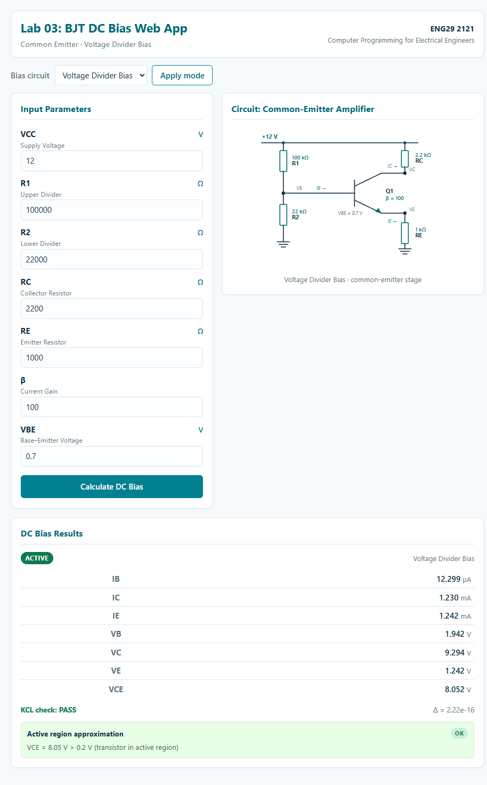

# Lab 3 — Validation Record (BJT DC Bias Web App)

วันที่ตรวจ: 2026-11-17
แอปที่ตรวจ: `http://127.0.0.1:5000/` (Flask dev server, Python 3.12)
เกณฑ์: `|ΔIC| ≤ 0.01 mA`, `|ΔVCE| ≤ 0.02 V` เทียบค่าที่แสดงกับค่าอ้างอิงที่ยังไม่ปัดเศษ

## 1. เครื่องมือที่ใช้ตรวจ และบทบาทของ MCP

| รายการ | ผล |
| --- | --- |
| วิธีตรวจหลัก | **Playwright MCP** (`@playwright/mcp`) ผ่านเครื่องมือ `browser_*` ใน OpenCode |
| ตรวจซ้ำด้วย | **OpenCode Browser** — ได้ผลตรงกันทุกกรณี (รอบแรกก่อนเพิ่ม `opencode.json`) |
| MCP config | `opencode.json` (OpenCode V2) · `"type": "local"` · `--browser chrome --isolated` |
| Node / npx | ตรวจแล้ว: `node v24.14.0`, `npx 11.9.0` |
| Console | ไม่มี error จากแอป — มีเพียง `404 /favicon.ico` ซึ่งไม่กระทบผลคำนวณ |

**MCP (Model Context Protocol)** คือมาตรฐานที่ให้แอป AI รู้ว่ามีเครื่องมืออะไร เรียกใช้เครื่องมือนั้น และรับผลกลับมา

- **OpenCode** เป็น host / **MCP Client** — เอเจนต์อยู่ฝั่งนี้
- **Playwright MCP** เป็น **MCP Server** — ใน `opencode.json` ใช้ `"type": "local"` จึงสตาร์ทเป็นโปรเซสในเครื่อง สื่อสารผ่าน `stdio` (ไม่ต้องเปิดพอร์ตของ MCP เอง)
- ลำดับข้อมูล: `OpenCode → (MCP) → Playwright MCP → Browser → (HTTP) → Flask + Python`
  แล้วส่งกลับ `หน้าเว็บ → Browser → MCP → OpenCode` เป็น snapshot ให้อ่าน
- เบราว์เซอร์คุยกับ Flask ด้วย HTTP ปกติ (ฟอร์ม POST) จึง **ไม่ต้องลง Playwright ใน `requirements.txt`**
- `--isolated` ให้ใช้โปรไฟล์ทดสอบแยก ไม่แตะเซสชัน Chrome ส่วนตัว

รอบสุดท้ายรันผ่าน Playwright MCP ตามที่ใบงานแนะนำ (ใช้ `browser_navigate`, `browser_snapshot`,
`browser_select_option`, `browser_fill_form`, `browser_click`, `browser_evaluate`) แล้วตรวจซ้ำด้วย
OpenCode Browser ได้ผลเหมือนกันทุกตัวเลข ทั้งสองวิธีอ่านจากหน้าเว็บจริง ไม่ได้ใช้ `curl` หรืออ่านโค้ดแทน

## 2. ผล A1–A5 (ตารางตามแบบใบงาน)

ใช้ร่วมกัน: `VCC = 12 V`, `RC = 2200 Ω` (2.2 kΩ), `β = 100`, `VBE = 0.70 V`
ฟอร์มรับหน่วย **Ω** (เช่น 1 MΩ = `1000000`)

| กรณี | เลือกโหมดและกรอกค่า | คาดหมายก่อนรัน | เห็นจริง (พร้อมหน่วย) | วิธีตรวจ | สถานะ |
| --- | --- | --- | --- | --- | --- |
| A1 · โหมดเดิม | Divider · R1=100000, R2=22000, RE=1000 | IC 1.229858 mA · VCE 8.052155 V (ตรงกับค่าอ้างอิงเดิม) | IC **1.230 mA** · VCE **8.052 V** · ACTIVE · KCL PASS | Playwright MCP | PASS |
| A2 · Fixed | Fixed · RB=1000000 (ไม่กรอก RE) | IC 1.130000 mA · VCE 9.514000 V | IC **1.130 mA** · VCE **9.514 V** · ACTIVE · KCL PASS | Playwright MCP | PASS |
| A3 · Emitter | Emitter · RB=1000000, RE=1000 (มีช่อง RE) | IC 1.026340 mA · VCE 8.705450 V | IC **1.026 mA** · VCE **8.705 V** · ACTIVE · KCL PASS | Playwright MCP | PASS |
| A4 · เปลี่ยนค่าเดียว | Emitter · เหมือน A3 แต่ RE=2000 | ทำนาย: **IC ลดลง** เพราะ `(β+1)RE` ในตัวหารเพิ่ม | IC **0.940 mA** · VCE **8.033 V** · ACTIVE · KCL PASS → ลดลงจริงตามทำนาย | Playwright MCP | PASS |
| A5 · อินพุตผิด | Fixed · RB=0 | มีข้อความให้แก้ RB, เว็บไม่ล่ม, ไม่แสดงผลเดิมเป็นผลรอบนี้ | `Fixed Bias — RB must be greater than zero.` · ไม่มีตารางผล · status ยังเป็น `No calculation yet / READY` | Playwright MCP | PASS |

หมายเหตุ: ผลทั้ง 5 กรณีข้างต้นตรวจซ้ำด้วย OpenCode Browser ได้ค่าและข้อความตรงกันทุกกรณี

### ตัวอย่างค่าอ้างอิงอิสระ — A2 (Fixed) คำนวณมือ ไม่ได้อ่านจากโปรแกรม

```
กำหนด  VCC = 12 V, VBE = 0.70 V, RB = 1,000,000 Ω, RC = 2,200 Ω, β = 100

IB = (VCC − VBE) / RB  = (12 − 0.70) / 1,000,000 = 11.3 µA
IC = β · IB            = 100 × 11.3 µA           = 1.130 mA
VE = 0 V,  VB = VBE    = 0.700 V
VC = VCC − IC·RC       = 12 − (0.001130 × 2200)  = 12 − 2.486 = 9.514 V
VCE = VC − VE          = 9.514 − 0              = 9.514 V
```

หน่วย: ตัวต้านทาน **Ω**, กระแส **A** ขณะคำนวณ แล้วแสดง IB เป็น **µA**, IC เป็น **mA**, แรงดันเป็น **V**
ค่าที่ได้ตรงกับที่อ่านจากหน้าเว็บ (IC 1.130 mA, VCE 9.514 V) ตามเกณฑ์ |Δ| ≤ 0.01 mA / 0.02 V

## 3. รายละเอียดผลที่อ่านได้ และส่วนต่าง

| เคส | IB | IC | IE | VB | VC | VE | VCE | Δ (KCL) |
| --- | --- | --- | --- | --- | --- | --- | --- | --- |
| A1 | 12.299 µA | 1.230 mA | 1.242 mA | 1.942 V | 9.294 V | 1.242 V | 8.052 V | 2.22e−16 |
| A2 | 11.300 µA | 1.130 mA | 1.141 mA | 0.700 V | 9.514 V | 0.000 V | 9.514 V | 4.34e−19 |
| A3 | 10.263 µA | 1.026 mA | 1.037 mA | 1.737 V | 9.742 V | 1.037 V | 8.705 V | 4.34e−19 |
| A4 | 9.401 µA | 0.940 mA | 0.950 mA | 2.599 V | 9.932 V | 1.899 V | 8.033 V | 2.22e−16 |

| เคส | ΔIC (mA) | ΔVCE (V) | อยู่ในเกณฑ์ |
| --- | --- | --- | --- |
| A1 | +0.000142 | −0.000155 | ✅ |
| A2 | 0.000000 | 0.000000 | ✅ |
| A3 | −0.000340 | −0.000450 | ✅ |
| A4 | −0.000100 | +0.000221 | ✅ |

## 4. ข้อสังเกตจากผลจริง

- **A4 เทียบ A3**: เปลี่ยนเฉพาะ `RE` จาก 1 kΩ → 2 kΩ ทำให้ `IC` ลด 1.026 → 0.940 mA
  และ `VCE` ลด 8.705 → 8.033 V (ยังอยู่ใน active region)
- **A2 (Fixed)**: `VE = 0.000 V`, `VB = VBE = 0.700 V` ตามแบบจำลอง emitter ต่อกราวด์ตรง
- **A5**: ข้อความมาจาก Flask ('`RB must be greater than zero.`') แสดงในหน้าเว็บ พร้อมชื่อโหมด
  และไม่มีผลรอบก่อนค้างอยู่
- ทุกเคส A1–A4 แสดง `Active region approximation · OK · VCE > 0.2 V`
  console มีเพียง `404 /favicon.ico` (ไม่มี error จากแอป)

## 5. ไล่เส้นทางข้อมูล `RE` ใน A4 (ฟอร์ม → Flask → สมการ)

1. **ฟอร์ม** — `templates/index.html` โหมด Emitter มี
   `<input type="number" id="re" name="re" value="2000">` (หน่วย Ω)
2. **Browser** ส่ง `POST /` พร้อม `mode=emitter`, `re=2000` และช่องอื่นเท่ากับ A3
3. **`app.py:107–108`** — `values = {name: float(form[name]) for name in MODE_FIELDS[mode]}`
   → `values["re"] = 2000.0` (แปลงข้อความเป็นตัวเลขครั้งเดียวที่นี่)
4. **`app.py:114`** — `result = SOLVERS[mode](**values)` → `SOLVERS["emitter"] = analyze_emitter_bias`
5. **`bjt.py:227`** รับ `re` → **`bjt.py:231`**
   `ib = (vcc - vbe) / (rb + (beta + 1) * re)`
   ตัวหาร A3 = `1 MΩ + 101×1 kΩ = 1.101 MΩ`, A4 = `1 MΩ + 101×2 kΩ = 1.202 MΩ`
   → `IB` ตก 10.263 → 9.401 µA → `IC = β·IB` ตก 1.026 → 0.940 mA
6. **`bjt.py:234`** `ve = ie * re` และ `vce = vc - ve` → `VCE` 8.705 → 8.033 V

ถ้าค่า `RE` ไม่เปลี่ยนผล ให้ตรวจตามลำดับ: ค่าในช่องฟอร์ม → `name="re"` กับ `MODE_FIELDS["emitter"]` →
`float()` ใน `app.py` → ฟังก์ชันที่ `SOLVERS` เลือก → `(beta + 1) * re` ใน `bjt.py`

## 6. หลักฐานภาพ

ผล A1 ที่ได้จาก Playwright MCP (วิธีตรวจหลัก):



ผล A1 จาก OpenCode Browser (รอบตรวจซ้ำ ผลตรงกัน):


## 7. การถดถอย Lab 2

ชุดทดสอบเดิมผ่าน **28/28** (`python -m unittest discover -v`) และอินพุตเดิม
`VCC=12, R1=47000, R2=10000, RC=4700, RE=1000, β=150, VBE=0.7` ยังให้
`IC = 1.324 mA`, `VCE = 4.446 V`, `ACTIVE`, `PASS` เหมือนเดิม

## 8. สิ่งที่ AI ช่วย / สิ่งที่ต้องตรวจเอง

- AI เขียน `analyze_fixed_bias`, `analyze_emitter_bias`, `_validate_inputs`, การเลือกโหมดใน `app.py`,
  ฟอร์มตามโหมด, `opencode.json` รัน A1–A5 ผ่าน Playwright MCP แล้วตรวจซ้ำด้วย OpenCode Browser
- สิ่งที่ตรวจจากสมการ Engineering Electronics: ตัวหาร `(β+1)RE`, `VE = 0` ใน Fixed,
  `IC = β·IB`, `VCE = VC − VE`, หน่วย Ω→A
- จุดแปลงหน่วย/เลือกฟังก์ชันอยู่ใน `app.py` (`MODE_FIELDS`, `SOLVERS`) ส่วนสมการอยู่ใน `bjt.py`
- **นักศึกษาทวนเอง 1 กรณีบนหน้าเว็บ** ตามข้อ 06–07 ของใบงาน (ยังไม่ได้ทำในเอกสารนี้)

---

# Lab 4 — BJT Common-Emitter Amplifier Simulator v1

วันที่ตรวจ: 2026-11-24
หน้าที่ตรวจ: `http://127.0.0.1:5000/` (Flask, Python 3.12) + ส่วน **Common-Emitter
Amplifier Simulator** ด้านล่างการ์ด Lab 3
เครื่องมือ: **Playwright MCP** (`browser_navigate`, `browser_snapshot`,
`browser_select_option`, `browser_fill_form`, `browser_click`, `browser_evaluate`,
`browser_resize`, `browser_take_screenshot`) บน browser จริง ทุกค่าอ่านจาก DOM
ที่ render แล้ว ไม่ได้อ่านจากโค้ดหรือใช้ `curl` แทน

## 9. เครื่องจำลองและวิธีเรียกใช้

| รายการ | ความจริงที่ตรวจได้ |
| --- | --- |
| ตัว solver | ngspice **47** (`ngspice-47`) ไฟล์พกพา `tools/ngspice/ngspice_con.exe` |
| ทางเลือกอื่น | ตั้ง `NGSPICE_EXE=<path>` ได้；ถ้าไม่มีจะหา `ngspice_con` / `ngspice` ใน PATH |
| วิธีเรียก | `subprocess.run([exe, "-b", "-o", log, cir], timeout=30)` — list args, ไม่ใช้ `shell=True` |
| ผลที่อ่าน | `.op` node voltages, `.print ac`, `.print tran` จาก log ข้อความจริง (ไม่ใช่ raw binary) |
| วงจร | CE voltage-divider, **RE ไม่ bypass**, `CIN/OUT=10 µF`, `RL=10 kΩ` |
| โมเดล BJT | `.model QNPN_ENG29 NPN (IS=1e-14 BF=100 VAF=100)` — แสดงในหน้าเว็บได้ |
| กัน結果เก่า | ทุก-run สร้าง temp dir ใหม่； error ไม่ render ตาราง/กราฟ/รายละเอียดเลย |
| Plugins ใหม่ | ไม่เพิ่ม dependency：กราฟ SVG เขียนใน `charts.py` จาก array ที่ parse ได้ |

หมายเหตุ: ngspice พิมพ์ `Warning: can't find the initialization file spinit.` ตอน start
แต่ `returncode = 0` และผลครบทุก analysis จึงไม่ถือเป็น failure

## 10. ผล B1–B8 จาก Playwright MCP

| รายการ | สิ่งที่ทำบน browser จริง | ผลที่อ่านได้ | สถานะ |
| --- | --- | --- | --- |
| **B1 · Regression** | วน Divider → Fixed → Emitter ด้วยชุด Lab 3 | Divider `IC 1.324 mA`, `VCE 4.446 V`, `ACTIVE`, `KCL PASS`; Fixed `IC 1.130 mA`, `VCE 9.514 V`; Emitter `IC 1.026 mA`, `VCE 8.705 V` — ตรงตาราง A1–A3 เดิมทุกตัว | PASS |
| **B2 · DC SPICE** | เลือก `.op` → **Run simulation** | status **Success** · `VB 1.949112 V`, `VE 1.289454 V`, `VC 9.189410 V`, `VCE 7.899956 V`, `IC 1.277541 mA` · badge **SPICE** · engine/version/model โชว์ชัด · มี netlist + log excerpt | PASS |
| **B3 · Change RE** | เปลี่ยน `#sim-re` 1000 → 2000 แล้ว run ใหม่ | `IC 1.277541 → 0.695855 mA`, `VCE 7.899956 → 9.064570 V`, `VB 1.949112 → 2.048198 V` — เปลี่ยนจริง ไม่มีค่าค้าง； SPICE และ Analytical ปรับตามทั้งคู่ | PASS |
| **B4 · AC** | เลือก `.ac` → run → อ่านกราฟ | gain สูงสุด **4.86 dB @ 489.779 Hz**, `fL 1.824 Hz`, `fH not determined in sweep range` · แกน frequency `1 … 1e+07 Hz` (log), gain `dB`, phase `deg` · polyline 2 เส้น × 351 จุดจาก `.print ac` จริง | PASS |
| **B5 · Transient** | 10 mV peak, 1 kHz, `.tran` | `Vin peak 9.998 mV`, `Vout peak 17.495 mV`, correlation **−1.0** → note `inverted (~180 deg): vout falls when vin rises` · แกนเวลา `0.00 … 4.99 ms` (5 รอบ) + แกน `Voltage (mV)` + legend `Vin`/`Vout` · 508 samples | PASS |
| **B6 · Change Source** | เปลี่ยนเป็น 20 mV / 2 kHz แล้ว run ใหม่ | `Vin 19.997 mV`, `Vout 34.990 mV`, แกนเวลา `0.00 … 2.50 ms` · netlist ที่โชว์เปลี่ยนเป็น `VIN vin_s 0 AC 0.02 SIN(0 0.02 2000 0 0)` และ `.tran 5e-06 0.0025 0` — พิสูจน์ว่ากราฟสร้างจาก run ปัจจุบัน | PASS |
| **B7 · Invalid / Fail** | ใส่ `RE = 0` → run | status **Error** · ข้อความจริง `Simulation failed — no stale results are shown. RE must be between 1 and 1e+07.` · ไม่มี `.sim-metrics`, `.chart-frame`, `.sim-compare`, `.sim-details` และไม่มีป้าย Success เหลืออยู่ | PASS |
| **B8 · UI** | 1440×1000 และ 390×844 + เปลี่ยนโหมดบนมือถือ | ไม่มี horizontal scroll (`scrollWidth == clientWidth` = 1425 / 375) · `.sim-grid` ยุบเป็น 1 column บนมือถือ · ปุ่มและช่องกรอกกว้างเกิน 24 px ทุกตัว · เปลี่ยนโหมดเป็น Fixed สำเร็จบน viewport เล็ก | PASS |

### หลักฐานภาพ (Playwright MCP)

- `docs/lab04-transient-10mv-1khz.png` — waveform ก่อนเปลี่ยน source (10 mV / 1 kHz)
- `docs/lab04-transient-20mv-2khz.png` — waveform หลังเปลี่ยน source (20 mV / 2 kHz)
- `docs/lab04-desktop-1440.png` — desktop, AC Bode + ผล SPICE
- `docs/lab04-mobile-390.png` — mobile, หน้าเดียวกัน
- `docs/lab04-mobile-mode-switch.png` — mobile หลังสลับไป Fixed bias

**ข้อจำกัดของการตรวจภาพ:** ใน session นี้โมเดลไม่รองรับ image input จึงไม่ได้อ่าน
pixel ของ PNG ด้วยตา การยืนยัน B8 ใช้ `browser_evaluate` อ่าน layout จริง
(scroll/client width, computed grid columns, element bounding boxes) ร่วมกับ
accessibility snapshot และ detector ของ Impeccable ตามด้านล่าง

## 11. การแยกป้าย SPICE / Analytical

ตาราง **Source attribution — SPICE vs Analytical (Lab 3)** แยก column ชัดเจน：

- กรณี DC: `SPICE (.op)` เทียบ `Analytical (Lab 3)` สำหรับ VB/VE/VC/VCE/IC
- กรณี AC/TRAN: ไม่มีสมการ AC analytic ในแอป จึงเขียนตรงไปตรงมาว่า Lab 3 เป็น
  **DC bias model only** และแสดงเฉพาะ DC operating point เป็นบริบท — ไม่ได้
  แต่งค่า analytical ด้าน AC ขึ้นมา
- หมายเหตุในหน้าเว็บอธิบายว่า SPICE ใช้โมเดล `IS/BF/VAF` ส่วน Lab 3 สมมติ
  β=100 / VBE=0.70 V คงที่ จึง **ไม่บังคับให้ตัวเลขตรงทุกหลัก**
  (ตัวอย่าง B2 ผลต่าง IC ≈ 0.05 mA, VCE ≈ 0.15 V เป็นผลจากสมมติฐานที่ต่างกัน)

## 12. Impeccable — ก่อน/หลัง และหลักฐาน

| ขั้นตอน | หลักฐาน |
| --- | --- |
|context | `/impeccable context` → `NO_PRODUCT_MD`, `hasVisualImplementation: false`, อนุญาต scoped fix บนโค้ดเดิม |
| ก่อน (Lab 3) | `docs/browser-a1-playwright.png` — หน้าเดิมไม่มี simulator； `.error`/`.warnings` เป็น one-sided border |
| detector รอบแรกบน URL จริง | `low-contrast` advisory: `span.status-flag` `#0e7a4f` on `#d7eeea` = **4.4:1** (ต้อง ≥4.5) + `nested-cards` warning 3 จุด (`.status-idle`, `.engine-chip`, `.sim-group`) |
| polish ที่ทำจริง | ปรับ `.status-flag` เป็น `#0a633f`; เปลี่ยน `.error`/`.warnings` เป็น full border + tint; ยุบ `.status-idle`, `.engine-chip`, `.sim-group` ให้เป็น divider แทนการ์ดซ้อน; ถอด background/border ของ `.simulator` ชั้นนอก; เพิ่ม `text-wrap: pretty`; มี `prefers-reduced-motion` สำหรับ status dot |
| detector รอบที่ 2 | 1280×800 → `[]`；390×844 → `[]` (after `text-wrap: pretty` บน empty state) |
| contrast ที่วัดใน browser หลังแก้ | body **13.0:1**, field label 13.6:1, hint/lede/help **4.98:1**, eyebrow 6.2:1, engine 7.25:1, status pill 5.04:1, note 7.36:1 — ผ่าน 4.5:1 ทุกจุดที่วัด |
| a11y อื่น | `h1` มี 1 ตัว, ลำดับ h1→h2→h3→h4 ถูกต้อง, ไม่มี control ไหนเล็กกว่า 24×24 px, ทุก input มี label ที่เชื่อมด้วย `for`/`id` |

## 13. ความคลาดเคลื่อน ข้อจำกัด และสิ่งที่นักศึกษาต้องทำเอง

- `f_high` ไม่มีในช่วง sweep 1 Hz – 10 MHz (gain ไม่ตก 3 dB). หน้าเว็บโชว์
  `not determined in sweep range` ตามความจริง ไม่ได้แต่งตัวเลขใส่
- ผล SPICE กับ Analytical ไม่เท่ากันทุกหลักเพราะโมเดลทรานซิสเตอร์ต่างกัน
  (ดูข้อ 11) — นี่คือ **การเปรียบเทียบ ไม่ใช่การเทียบความถูกต้องหลักต่อหลัก**
- ฟอร์มรับเฉพาะ Ω / µF / mV / Hz； ไม่มี circuit editor, ไม่มี bypass capacitor,
  ไม่มี parameter sweep อัตโนมัติ
- ใช้ ngspice แบบพกพาในเครื่องนี้； `tools/ngspice/` ถูก ignore ใน `.gitignore`
  (ไฟล์ execute ขนาด ~19 MB ไม่ควรถูก commit) — คน clone ต้องโหลด/ตั้ง `NGSPICE_EXE` เอง
- **ชุดทดสอบเดิม 28/28 ยังผ่าน** (`python -m unittest discover -v`) และอินพุต
  Lab 3 เดิมยังให้ `IC = 1.324 mA`, `VCE = 4.446 V`, `ACTIVE`, `PASS`
- **นักศึกษาต้องทวนเอง 1 กรณีบนหน้าเว็บ** ตามข้อ 06–07 ของใบงาน Lab 3
  (แนะนำ A4: Emitter · RB=1 MΩ · RE=2000 Ω) — ยังไม่ได้ทำแทน
